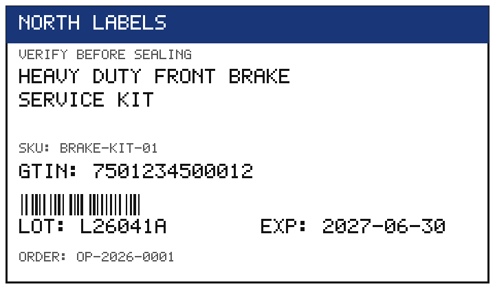
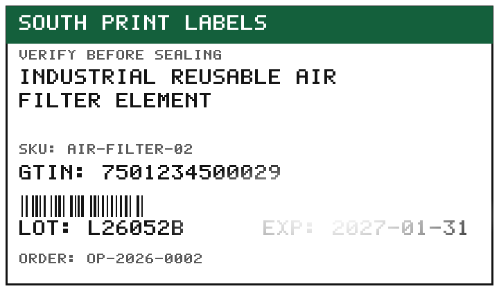

# PackCheck

A validation gate for box labels and box contents that runs **before the box is sealed**.
No box should ever be sealed without cross-checking product text, GTIN code, expiry date, lot, and the complete kit contents against its production order in SQL.

Written in Go (CLI + library) with embedded SQLite and a single external dependency: the pure-Go SQLite driver `modernc.org/sqlite`. Everything else is the standard library, including the PNG label-image generation.

## The problem

At the packing station, three sources of truth coexist without being systematically cross-checked: what the printed label says, what the box physically contains, and what the production order requires. When one of them differs, the error travels sealed to the customer.

- **Wrong label.** Text or GTIN of a different product or presentation, caused by an order change without a roll change, a manual reprint, or labels mixed between lines.
- **Illegible or wrong date.** Faint, blurry, film-glared, or curved-surface printing. An unreadable expiry date is, to the customer and to regulators, a missing expiry date. A readable but wrong one breaks FIFO rotation and can ship expired product.
- **Wrong lot.** Without a trustworthy lot there is no traceability. Faced with a complaint or a recall, the company cannot scope it and must recall more than necessary.
- **Incomplete kit or extras.** The customer stops their line, returns the whole lot, and applies the contractual fine per rejected box, not per missing part.
- **Uncontrolled variability.** Different label fonts and suppliers change contrast and layout. Human visual inspection fatigues over a shift, and its judgment is neither reproducible nor auditable.

The cost grows with distance: detecting the error at the packing table takes seconds; detecting it at the customer's warehouse costs returns, freight, fines, re-invoicing, 100% re-inspection, and trust. The systemic cause is not the operator: it is the absence of a verifiable gate between "box ready" and "box sealed" that leaves evidence.

The full formal description, with rules, test matrix, and acceptance gates, lives in the [design specification](docs/superpowers/specs/2026-11-05-packcheck-label-validation-design.md).

## Objective

1. **Detect 100% of critical errors before sealing**: GTIN, lot, expiry, missing kit items, and nonexistent orders. A critical field never passes because it is "close enough".
2. **Treat "cannot be read" as a first-class outcome**: an illegible label means rejection for reprint or rescan, never a guess.
3. **Measure reading quality per field** with CER and successful-read rate, broken down by degradation profile, font, and supplier.
4. **Zero false rejects on clean labels**, measured per shift, so the gate never becomes an obstacle staff learn to bypass.
5. **Negligible cycle time** against line pace: milliseconds as the bound, microseconds in measured practice.
6. **Evidence verifiable by humans and by machines**: per-case PNG images, a manifest with SHA-256 fingerprints and ground truth, JSON/HTML/text reports, and end-to-end integration tests.
7. **OCR isolated behind a port**: everything is proven today without hardware using a deterministic simulator; tomorrow Tesseract (adapter included) or another engine plugs in without rewriting validators.

Out of scope in this version: cameras/PLCs, physical printing, authentication, an HTTP API, and multi-plant operation.

## Quick start

Requirement: Go 1.24 or newer (developed and tested with `go1.27.3 windows/amd64`). Tesseract is optional and only needed with `--engine tesseract`.

```powershell
go build -o packcheck.exe ./cmd/packcheck
.\packcheck.exe seed --db evidence\packcheck.db
.\packcheck.exe runbatch --db evidence\packcheck.db --out evidence
```

On Linux/macOS: `go build -o packcheck ./cmd/packcheck` and `/` paths.

| Command | What it does |
|---|---|
| `seed --db <path.db>` | Creates the SQLite database and seeds the demo orders (several suppliers/fonts). |
| `genlabels --db <path.db> --out <dir>` | Generates every label PNG and `manifest.json` with SHA-256 fingerprints. |
| `runbatch --db <path.db> --out <dir> [--engine simulator\|tesseract]` | Full flow: images, OCR reading, SQL cross-check, metrics, and reports. |
| `validate --db <path.db> --input <scans.json> [--out <json>]` | Validates arbitrary scans against the SQL orders table. |
| `version` | Prints the version. |

Exit codes: `0` ok, `1` usage/internal error, `2` at least one box rejected in `validate`, `3` the batch does not match expectations in `runbatch`. They are the contract for any automated system (CI, PLC gateway, scripts).

Example `validate` input (a single scan object at the root is also accepted):

```json
{
  "scans": [{
    "box_id": "BOX-1001", "order_id": "OP-2026-0001", "shift": "A",
    "label": {
      "product_text": "HEAVY DUTY FRONT BRAKE SERVICE KIT",
      "gtin": "7501234500012", "lot": "L26041A", "expiry_text": "2027-06-30"
    },
    "contents": [
      {"code": "PAD-01", "qty": 4},
      {"code": "ROTOR-01", "qty": 2},
      {"code": "GREASE-05G", "qty": 1}
    ]
  }]
}
```

One-command verification (format, vet, tests, evidence batch, and analyzers when installed):

```powershell
.\scripts\verify.ps1
```

Bash equivalent: `bash scripts/verify.sh`. The same gates also run in the [CI pipeline](.github/workflows/ci.yml).

## Library usage

```go
store, _ := sqlite.Open("orders.db") // packcheck/internal/store/sqlite
validator, _ := validation.NewBoxValidator(store, ports.SystemClock{}, validation.DefaultConfig())
res, err := validator.ValidateBox(ctx, domain.BoxScan{
    BoxID: "BOX-1", OrderID: "OP-2026-0001", Shift: "A",
    Label: domain.ManualReading("HEAVY DUTY FRONT BRAKE SERVICE KIT", "7501234500012", "L26041A", "2027-06-30"),
    Contents: []domain.ContentItem{{Code: "PAD-01", Qty: 4}, {Code: "ROTOR-01", Qty: 2}, {Code: "GREASE-05G", Qty: 1}},
})
// res.Verdict: pass | pass_with_warnings | reject; res.Findings explains every field.
```

## Validation rules

Severities: `critical` and `major` reject the box; `minor` passes with warnings (`pass_with_warnings`).

| Field | Rule | Code on failure | Severity |
|---|---|---|---|
| Order | Must exist in the SQL orders table | `ORDER_NOT_FOUND` | critical |
| Text | Normalized equality; CER ≤ 0.05 counts as tolerable degradation | `TEXT_MISMATCH` / `TEXT_DEGRADED` | critical / minor |
| Text | Empty | `TEXT_MISSING` | critical |
| GTIN | Valid GTIN-13 check digit, identical to the order's | `GTIN_INVALID` / `GTIN_MISMATCH` | critical |
| Expiry | Parseable, identical to the order's, not expired | `EXPIRY_UNREADABLE` / `EXPIRY_MISMATCH` / `EXPIRY_EXPIRED` | critical |
| Lot | Well-formed and identical to the order's | `LOT_INVALID` / `LOT_MISMATCH` | critical |
| Contents | Missing item or short quantity | `CONTENT_MISSING` / `CONTENT_SHORT` | critical |
| Contents | Extra item or excess quantity | `CONTENT_EXTRA` / `CONTENT_OVER` | major |
| Legibility | Confidence ≥ 0.80 and legibility ≥ 0.70 (when reported) | `LABEL_ILLEGIBLE` | major |

Critical fields require exact equality after normalization (case, accents, spacing). Accepted expiry formats: `2006-01-02`, `02/01/2006`, `02-01-2006`, `20060102`, `01/2006`, and `2006-01` (month-year means the last day of that month).

## Tests: verifiable by humans and by machines

The demo matrix declares its ground truth **before** anything runs: expected verdict and expected finding codes per case. A human opens the PNG and `report.html`; a machine reads `manifest.json` / `batch-report.json` and runs `go test ./...`. There are no claims without artifacts.

| # | Case | Expected |
|---|---|---|
| 01 | Clean, font A, North supplier | `pass` |
| 02 | Clean, font B, South supplier | `pass` |
| 03 | Faint print | `pass_with_warnings` (`TEXT_DEGRADED`, CER > 0) |
| 04 | Curved surface | `pass_with_warnings` (`TEXT_DEGRADED`, CER > 0) |
| 05 | Blurry | `reject` (`LABEL_ILLEGIBLE`) |
| 06 | Glare over the expiry date | `reject` (`LABEL_ILLEGIBLE` + `EXPIRY_UNREADABLE`) |
| 07-15, 17 | Seeded **critical** errors: foreign GTIN, invalid check digit, wrong lot, wrong/expired/unreadable expiry, wrong product label, missing kit item, short quantity, order missing from SQL | `reject` (all must be detected) |
| 16 | Extra component (seeded *major*) | `reject` (`CONTENT_EXTRA`) |




*Above: two of the generated images (clean font A, and glare covering the expiry date). The rest are in [evidence/labels](evidence/labels).*

### Generated evidence

`runbatch` writes into the output directory:

- `labels/*.png` — one image per case (fonts/suppliers and faint, curved, blurry, and glare degradations).
- `manifest.json` — per-case truth, expected verdict, and each image's SHA-256.
- `batch-report.json` — reading, findings, verdict, and per-case and aggregated metrics.
- `report.html` — the same content for human review, with images.
- `summary.txt` — a one-screen terminal summary.
- `packcheck.db` — the SQLite database with the cross-checked orders table.

The integration tests (`internal/app/integration_test.go`, `cmd/packcheck/main_test.go`) walk the real flow: file-backed SQLite → SQL seeding → PNGs + manifest with recomputed fingerprints → OCR port → SQL validation → metrics, asserting every verdict and every gate.

### Metrics (operational definitions)

- **Per-field CER** = `levenshtein(printed, read) / runes(printed)`, measured against what is **printed** on the label (OCR fidelity), not against the order. Cross-checking the order is the validators' job.
- **Per-field successful-read rate** = readings exactly equal after normalization / attempts.
- **Seeded-error recall** = seeded errors rejected / seeded errors. Gate: **100% on criticals**.
- **False reject** = the truth said pass and the system rejected; reported per shift. An illegibility rejection whose truth is `reject` is a correct "no-read", not a false reject.
- **Returns before/after**: in the demo batch, *before* counts the critical errors that would ship without a gate (all of them) and *after* counts those that escape with the gate. It is a **batch simulation**, not plant history; the report labels it as such.
- **Cycle time per box**: `ValidateBox` duration on a monotonic clock (mean, p50, p95, max). On coarse-tick clocks a single validation can measure 0 ns by resolution; the valid measurement is then the repeated one (N validations / N), exactly what the Go benchmark harness does. The integration test asserts the gate with that technique.

### Observed results (development machine)

Real batch output: `Cases: 17 | Passed: 4 | Rejected: 13 | Matching expectations: 17/17`, `Critical recall: 100.0% (10/10)`, `Seeded-error recall: 100.0% (11/11)`, `False rejects: 0`, critical escapes `10 → 0`, per-field reading: text 76.5% success (mean CER 0.0102), GTIN 100%, lot 100%, expiry 94.1% (glare blocks one read). Cycle measured by repetition against SQLite: **26 µs per box** (500 validations in 13.0 ms). Benchmarks (`-benchtime=20000x`): in-memory validation ≈ 2.8 µs/op; ASCII-path CER at 2 allocations/op.

Verified quality: `go vet` clean; `go test ./...` green (56-93% statement coverage per package; cores `metrics` 93.3% and `validation` 90.7%); `go test -race` clean for `app`, `validation`, and `sqlite`; `staticcheck` with no findings; `gosec` at zero after the documented triage; `govulncheck`: *"No vulnerabilities found"*. Reproduce with `.\scripts\verify.ps1` or in CI.

## Architecture

Hexagonal (ports and adapters): the domain knows nothing about SQL, OCR, or files, and every boundary is an interface that tests can substitute.

```text
cmd/packcheck          thin CLI (flags, exit codes)
internal/app           use cases, demo batch with ground truth, orchestration
internal/domain        pure entities and rules (GTIN, dates, lot, normalization)
internal/ports         interfaces: OrderRepository, OCREngine, Clock
internal/validation    the gate: per-field Strategy + accumulating chain
internal/metrics       CER (two-row Levenshtein + ASCII fast path), rates, percentiles
internal/store/sqlite  SQLite adapter: embedded schema, parameterized queries
internal/ocr           deterministic simulator + optional Tesseract adapter (Factory)
internal/labelgen      stdlib PNG generation: bitmap font, profiles, degradations
internal/report        JSON / HTML (html/template) / text from one model
```

Patterns with a purpose, not from a catalogue: **Hexagonal** to isolate hardware and SQL; **Strategy + Chain** so one bad field never hides another and each rule is testable alone; **Repository** for the SQL cross-check; **Factory** to choose the OCR engine without branches in the domain; an **injectable clock** for deterministic expiry and cycle measurement. No mutable global state: `BoxValidator` is safe for concurrent use (verified with `-race`).

## Security

- SQL is **100% parameterized** with contexts; an injection probe test must fail closed (`ORDER_NOT_FOUND`, table intact).
- Tesseract runs only via `exec.CommandContext` with an argument list, **no shell**, binary resolved with `LookPath`, image path made absolute (never parseable as a flag), verified as a regular file, and timed out.
- Writes are confined with `os.OpenRoot` (neither `..` names nor symlinks escape the destination directory) with `0600`/`0750` permissions.
- JSON input is capped at 10 MiB via `LimitReader`; HTML uses `html/template` with automatic escaping (covered by an XSS test).
- No secrets in the repository, no `unsafe`, no `math/rand`, no network surface. SHA-256 is used only as an evidence-integrity fingerprint.
- 4 `#nosec` annotations with written justifications in code (controlled subprocess, explicit local-operator reads, and one bounded conversion gosec cannot prove). Full detail with IDs, severity, and line numbers in [security_best_practices_report.md](security_best_practices_report.md).

## Honest limitations

- **The deterministic simulator does not read pixels**: it models typical OCR errors from the printed truth so metrics are reproducible without hardware. Real pixel reading is the Tesseract adapter; on a machine without Tesseract the system says so explicitly (`ErrTesseractUnavailable`) instead of silently simulating. Install it and use `--engine tesseract` for real OCR.
- The bars next to the GTIN are **deterministic visual evidence, not a decodable EAN**; the code truth is the printed digits and their GTIN-13 check digit.
- The typeface is an in-house 5x7 bitmap font (profile B = bold stroke + tracking). It represents the *class* of inter-supplier variability, not a specific commercial font.
- A product name that does not fit in 3 lines × 28 characters is printed clipped on generated labels; validation still compares the full order name. Keep production label names short.
- The demo "returns before/after" figures are a batch simulation (escapes), not plant history.
- Single-writer SQLite is the right choice for a local station and for tests; a plant with many concurrent stations should move the repository behind the same port to PostgreSQL/MySQL without touching the domain or the validators.
